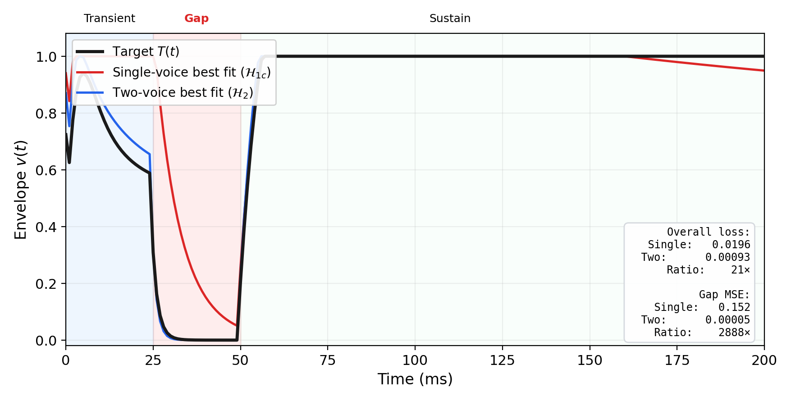

# Hodgkin–Huxley Envelope Unit (HEU)

A research archive for the first **Hodgkin–Huxley Envelope Unit** experiments: continuous-time excitable dynamics for temporal envelopes and event commitment.



## Paper

**[Expressivity Separation in Excitable Dynamics: Single-State Units Cannot Represent Conflicting Temporal Regimes](docs/paper/paper-draft-v1.md)**

The draft presents a constructive separation between single-state and two-voice HEU architectures. It includes controlled experiments in tempo locking, voice coupling, envelope fitting, and conflicting temporal regimes, followed by an uncoupled-parameter ablation.

Key reported results:

- phase-locking value of `1.0` across 90–140 BPM;
- fitting loss below `0.001` for three articulation targets;
- a `7.7×` overall single-state gap after removing parameter coupling;
- a `510×` gap in the critical temporal region;
- a `21×` separation between coupled single-voice and two-voice fits.

This repository preserves a research draft and its experimental evidence; it is not a peer-reviewed publication.

## Archive map

| Path | Contents |
| --- | --- |
| [`docs/paper/`](docs/paper/) | Full paper draft, component sections, four figures, and figure generator |
| [`notebooks/`](notebooks/) | Six executed tutorials, from core dynamics through the separation experiment |
| [`hh_envelope/experiments/`](hh_envelope/experiments/) | Experiment 01–05 implementations and diagnostics |
| [`results/`](results/) | Committed JSON diagnostics, NumPy arrays, and generated plots |
| [`hh_envelope/`](hh_envelope/) | HEU dynamics, coupling, articulation, optimization, and plotting code |
| [`PROVENANCE.md`](PROVENANCE.md) | Exact private-source revision and extraction decisions |
| [`VALIDATION.md`](VALIDATION.md) | Test, smoke-run, credential-scan, and figure-regeneration evidence |

### Notebooks

1. [Introduction and core concepts](notebooks/00_introduction_and_core_concepts.ipynb)
2. [Tempo locking — Experiment 01](notebooks/01_tempo_locking_exp01.ipynb)
3. [Two-voice coupling — Experiment 02](notebooks/02_two_voice_coupling_exp02.ipynb)
4. [Envelope fitting — Experiment 03](notebooks/03_envelope_fitting_exp03.ipynb)
5. [Conflicting-regime separation — Experiment 04](notebooks/04_impossibility_proof_exp04.ipynb)
6. [Advanced topics](notebooks/05_advanced_topics.ipynb)

The committed notebooks retain their historical outputs so they can be inspected directly on GitHub.

## Run locally

Requires Python 3.11 or newer and [uv](https://docs.astral.sh/uv/).

```bash
git clone https://github.com/Bakobiibizo/heu.git
cd heu
uv sync --all-extras
```

Run a focused experiment:

```bash
MPLBACKEND=Agg uv run python run.py exp01
MPLBACKEND=Agg uv run python run.py exp04
MPLBACKEND=Agg uv run python run.py exp05
```

Experiments 03–05 run numerical optimization and take longer than Experiment 01. Commands can update files beneath `results/`.

Open the tutorials:

```bash
uv run jupyter lab
```

Regenerate the paper figures from committed arrays:

```bash
MPLBACKEND=Agg uv run python docs/paper/generate_figures.py
```

Run the focused validation suite:

```bash
uv run pytest -q hh_envelope/core/tests hh_transcriber/experiments/diagnostics/_self_test.py
```

## License

MIT © 2026 Bakobiibizo. See [`LICENSE`](LICENSE).
