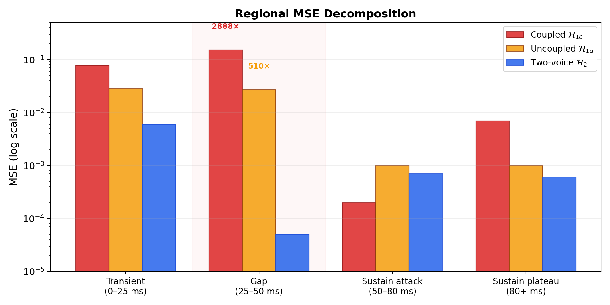

# Expressivity Separation in Excitable Dynamics: Single-State Units Cannot Represent Conflicting Temporal Regimes

---

## Abstract

We study expressivity limits of excitable dynamical units used for event commitment. We define the *single-voice HEU* (Hodgkin-Huxley Envelope Unit), a continuous-time system with a single envelope state, and construct a target requiring fast transient decay followed by stable sustain. A minimal two-voice HEU matches this target, but any single-voice HEU incurs substantially higher error: the best single-voice solution is 7.7× worse overall and 510× worse in the critical gap region where the conflict is most acute.

Parameter coupling worsens, but does not cause, the limitation: enforcing a single balance parameter that trades off attack against recovery further degrades single-voice performance (2.75× worse than an uncoupled single-voice), yielding a 21× total gap to two-voice. Within this single-state HEU family, decoupling attack and recovery parameters does not remove the separation.

We validate basic dynamics (tempo locking, envelope fitting) and show the same failure mode in polyphonic transcription as note fragmentation (3–5× over-detection at correct pitch), where stabilizing dynamics improves piano F1 from 0.054 to 0.731.

---

## Introduction

Detecting salient events in continuous signals is a fundamental problem across domains: note onsets in audio, action potentials in neural recordings, anomalies in sensor streams. The task requires more than classification; it demands **event commitment**, the decision of *when* to act given accumulating but ambiguous evidence, followed by suppression of redundant responses until new evidence warrants another commitment.

Standard approaches frame event detection as frame-wise classification followed by post-hoc peak-picking or thresholding. This two-stage pipeline introduces a fundamental mismatch: the classifier optimizes per-frame accuracy while the downstream consumer needs sparse, well-timed discrete events. The result is either fragmented outputs (multiple detections per event) or missed events (over-smoothed posteriors that fail to cross threshold).

Biological systems solve this problem differently. Neurons accumulate evidence through membrane potential dynamics, commit to action potentials when threshold is crossed, and enforce refractory periods that prevent immediate re-firing. This architecture couples evidence accumulation, threshold commitment, and temporal suppression into a single dynamical system rather than a pipeline of independent stages.

We ask: **what are the expressivity limits of excitable systems whose temporal behavior is governed by a single dynamical state?**

---

### Contribution

We introduce the **Hodgkin-Huxley Envelope Unit (HEU)**, a continuous-time dynamical system inspired by excitable neuron models [1–5] but designed for signal processing rather than biological simulation. The HEU maps continuous excitation to a bounded envelope state, produces discrete spike events at threshold crossings, and enforces refractory suppression, all through coupled differential equations with a small, interpretable parameter set.

Our central contribution is a **constructive expressivity separation**: we exhibit a temporal target that single-voice HEUs cannot represent while a minimal two-voice extension succeeds. The separation is primarily due to the **single-state constraint**: one envelope variable cannot represent conflicting temporal regimes. An ablation removing the balance coupling (allowing independent attack and recovery strengths) improves single-voice loss by 2.75×, but the uncoupled single-voice remains 7.7× worse than two-voice, with the critical gap region 510× worse. Within this HEU family, the bottleneck is the number of dynamical states, not the parameter organization.

We validate the HEU through controlled experiments (tempo locking across 90–140 BPM, parameter optimization for musical articulations) and apply it to polyphonic music transcription, where the same bottleneck manifests as note fragmentation. On polyphonic piano content (9-file evaluation set, 50 ms onset tolerance), a single-voice HEU bank exhibits envelope oscillation that fragments notes into 3–5× redundant detections. Stabilizing the dynamics yields an order-of-magnitude improvement in F1 (0.054 → 0.731).

---

### Scope and Non-Claims

The HEU is a **non-learning** system. All behavior is determined by fixed parameters and state evolution; there are no learned weights. This is intentional: we aim to characterize the expressivity of excitable dynamics themselves, not the capacity of learned approximations.

We do not claim that the HEU outperforms state-of-the-art transcription systems, which use learned models with orders of magnitude more parameters. The transcription application demonstrates that the theoretical expressivity limit manifests as a practical performance bottleneck, not that excitable units are the optimal solution to transcription.

The separation result is **constructive, not universal**. We exhibit one target that single-voice cannot represent within this HEU family; we do not characterize the full class of such targets, nor do we claim that a different single-state dynamical form could not represent this specific target. The result establishes that the expressivity gap exists and is non-trivial (7.7× even without coupling), not that it is maximal.

---

### Paper Outline

**Section 2 (Model)** formally defines three model classes (coupled single-voice, uncoupled single-voice, two-voice): envelope dynamics, spike emission, refractory mechanism, and parameterization.

**Section 3 (Separation Result)** constructs the target with conflicting temporal requirements, states the expressivity separation as a proposition, presents the main experimental evidence, and confirms via ablation that the bottleneck is the single-state constraint rather than the parameter coupling.

**Section 4 (Validation)** briefly validates the HEU through tempo locking and envelope fitting experiments that establish baseline dynamical coherence.

**Section 5 (Application)** applies the HEU to polyphonic audio transcription, demonstrating that the separation manifests as note fragmentation in a real pipeline.

**Section 6 (Related Work)** positions the HEU against Hodgkin-Huxley models, spiking neural networks, onset detection methods, and expressivity results in neural architectures.

**Section 7 (Discussion)** interprets the separation, addresses the uncoupled-parameter ablation, and suggests extensions.

**Appendix A** provides full gate dynamics equations, parameter bounds, and supplementary experiments (two-voice coupling stability).

---

### Summary of Results

| Claim | Evidence |
|-------|----------|
| Single-state is the primary bottleneck (Claim A) | $\mathcal{H}_{1u}$ loss = 0.0071; still 7.7× worse than $\mathcal{H}_2$, gap region 510× worse (Exp. 5) |
| Coupling worsens the limitation (Claim B) | $\mathcal{H}_{1c}$ loss = 0.0196; 2.75× worse than $\mathcal{H}_{1u}$ (Exp. 4 + 5) |
| Two-voice resolves both constraints | $\mathcal{H}_2$ loss = 0.00093; 21× better than $\mathcal{H}_{1c}$ (Exp. 4) |
| Single HEU phase-locks to rhythmic input | PLV = 1.0 at 90–140 BPM (Exp. 1) |
| Parameter optimization finds good solutions | Loss < 0.001 for staccato, legato, grace note targets (Exp. 3) |
| Transcription bottleneck is fragmentation, not recall | Baseline recall = 97%, precision = 21% (Application) |
| Stabilization yields order-of-magnitude F1 improvement | F1: 0.054 → 0.731 on piano (Application) |

The core message: **single-state excitable dynamics have strict expressivity limits for targets with conflicting temporal regimes, and those limits matter in practice.**

---

## Model

### Overview

We study the **HEU**, a continuous-time dynamical unit designed for sparse event commitment in scalar input signals. The HEU maps a continuous excitation signal $x(t)$ to a bounded internal envelope $v(t) \in [0,1]$ and produces discrete spike events when sufficient evidence accumulates.

The HEU retains the core excitable structure of Hodgkin-Huxley dynamics [1] — competing growth and decay processes, threshold commitment, and refractory suppression — but parameterizes for interpretability and optimization rather than biological fidelity. This paper focuses on the single-unit case; multi-unit composition is addressed in future work.

The HEU is **non-learning**: all behavior is determined by fixed parameters and state evolution. Its design explicitly separates:

1. evidence accumulation,
2. state-dependent decay,
3. spike emission,
4. post-spike refractoriness,
5. long-term activity regulation.

We use "evidence" descriptively to denote accumulated excitation, without probabilistic interpretation.

---

### Continuous-Time Dynamics

Let $x(t) \in \mathbb{R}_{\ge 0}$ denote the excitation signal. The excitation signal may contain both transient (pulsed) components and tonic (sustained) components; the HEU dynamics treat both uniformly through the same accumulation mechanism. In the concrete implementation, the combined drive is $d(t) = x(t) \cdot g + \text{tonic}$, where $g$ is a gain factor and the tonic term provides sustained baseline excitation for articulations that require non-zero sustain (see Appendix A.7 for per-experiment input specifications).

The HEU maintains a scalar envelope state $v(t) \in [0,1]$, whose dynamics are governed by competing growth and decay processes:

$$\frac{dv(t)}{dt} = \underbrace{G\big(x(t), v(t)\big)}_{\text{excitation-driven growth}} - \underbrace{R\big(v(t)\big)}_{\text{recovery-driven decay}} - \underbrace{L\big(v(t)\big)}_{\text{leak (optional)}}$$

where each term is bounded and state-dependent. All results hold for any bounded, monotone excitation transform in $G$ and any monotone recovery function in $R$. In experiments, we use sigmoid-shaped gate functions (standard logistic $\sigma(z) = 1/(1 + e^{-z})$); full gate dynamics are provided in Appendix A.1.

**Notation convention.** This section presents the model in abstract functional form ($\alpha(v)$, $\beta(v)$). The concrete implementation (Appendix A.1) realizes $\alpha(v)$ as a scalar strength $\alpha$ multiplied by a state-dependent gate variable $a(t)$, and $\beta(v)$ as scalar $\beta$ times gate $r(t)$. The implementation also includes a direct-input term ($0.55 \cdot \text{drive}$) that provides baseline responsiveness outside the gated dynamics. All experimental results use the concrete form.

---

### Excitation-Driven Growth

The growth term integrates incoming excitation while enforcing saturation:

$$G(x, v) = \alpha(v) \cdot g(x) \cdot (1 - v)$$

where:

- $g(x)$ is a non-negative, bounded transform of the input excitation,
- $\alpha(v) > 0$ is the effective attack rate, modulated by envelope state,
- the factor $(1 - v)$ enforces saturation at $v = 1$.

This form ensures that growth diminishes as the envelope approaches its upper bound.

---

### Recovery-Driven Decay

The decay term drives the envelope back toward zero:

$$R(v) = \beta(v) \cdot v$$

where $\beta(v) > 0$ is the recovery strength, modulated by envelope state.

Recovery is state-dependent: higher envelope values induce stronger decay, enabling rapid suppression after large excursions.

---

### Coupled Gate Dynamics and Balance Constraint

In the HEU, excitation-driven growth and recovery-driven decay are not independently parameterized. Both processes are gated by state-dependent activations that share a common balance parameter $\theta_{\text{balance}}$. This parameter controls the relative contribution of attack and recovery to the envelope derivative: attack-biased settings ($\theta_{\text{balance}} > 0$) favor sustained envelope values, while recovery-biased settings ($\theta_{\text{balance}} < 0$) favor rapid return to baseline.

Crucially, there is no parameterization that achieves both simultaneously; the tradeoff is structural. Increasing attack persistence necessarily weakens recovery, and increasing recovery strength necessarily reduces attack persistence. This coupling worsens the expressivity limits demonstrated in the following section, though the primary bottleneck is the single envelope state itself.

---

### Leak Term (Optional)

An optional leak term provides slow baseline decay:

$$L(v) = \lambda \cdot v$$

with $\lambda \ge 0$. In all experiments, $\lambda = 0.1$, providing passive drift toward zero in the absence of excitation. This is small relative to typical recovery strength ($\beta \approx 0.6$ at default parameters) and does not qualitatively affect the separation result.

---

### Spike Emission

A spike event is emitted when the envelope crosses a fixed threshold:

$$\text{spike at time } t \quad \text{if} \quad v(t) \ge v_{\text{thresh}}$$

Spike emission does **not** reset the envelope state. Instead, it triggers a refractory mechanism that temporarily suppresses further spike emission.

This design decouples envelope dynamics from spike timing, allowing the envelope to encode evidence independently of event commitment.

---

### Refractory Mechanism

After a spike, the HEU enters a refractory period of duration $\tau_{\text{ref}}$, during which additional spikes are suppressed:

$$\text{spike allowed} \iff \text{refractory\_remaining}(t) = 0$$

The refractory state evolves deterministically as a countdown timer. Importantly, refractoriness **does not alter** the envelope dynamics $v(t)$; it only gates spike emission.

This separation allows the HEU to accumulate evidence during refractory periods without committing additional events.

---

### Homeostatic Regulation

To ensure long-term stability across varying excitation statistics, the HEU tracks a slow exponential moving average of activity:

$$a(t) = \text{EMA}\big(\text{spikes}(t)\big)$$

When activity exceeds a target range, a damping factor reduces effective excitation gain. Homeostasis acts on a timescale orders of magnitude slower than envelope dynamics and does not affect short-term behavior.

Homeostatic regulation is disabled in the separation experiments (Sections 3 and 4); the result does not depend on it. Homeostasis is included for completeness and long-term stability in downstream applications (Section 5).

---

### Parameterization via Normalized Coordinates

All HEU parameters are expressed through a normalized vector

$$\theta \in \Theta \subset \mathbb{R}^d$$

with bounded components.

Each component of $\theta$ is mapped to a physical parameter (e.g., $\tau_{\text{attack}}$, $\tau_{\text{recovery}}$, $\theta_{\text{balance}}$) via exponential or sigmoid transforms. This ensures:

- positivity where required,
- bounded dynamics,
- numerical stability during optimization.

Crucially, **all parameters are global**: a single parameterization governs behavior across all temporal regimes of the input.

---

### Model Classes

We define three model classes of increasing expressivity. The separation result compares all three.

> **Definition 1** (Single-voice coupled HEU class $\mathcal{H}_{1c}$). A *coupled single-voice HEU* is a continuous-time dynamical system $(v, a, r, \rho)$ satisfying:
>
> 1. **Single envelope state.** Exactly one scalar envelope $v(t) \in [0,1]$.
>
> 2. **Bounded monotone growth.** $G(x, v) = \alpha \cdot f_a(v, x) \cdot (1 - v) \cdot g(x)$ where $f_a$ is monotone non-decreasing in its arguments and $g$ is a bounded non-negative transform.
>
> 3. **Bounded monotone recovery.** $R(v) = \beta \cdot f_r(v) \cdot v$ where $f_r$ is monotone non-decreasing.
>
> 4. **Balance coupling.** Attack strength $\alpha$ and recovery strength $\beta$ are jointly determined by a total conductance $g_{\text{total}}$ and a single balance parameter: $\alpha = g_{\text{total}} \cdot \sigma(\theta_{\text{balance}})$, $\beta = g_{\text{total}} \cdot (1 - \sigma(\theta_{\text{balance}}))$, where $\sigma$ is a monotone surjection onto $(0,1)$ (standard logistic in all experiments; see Appendix A.1).
>
> 5. **Global parameters.** A single parameter vector $\theta \in \Theta \subset \mathbb{R}^4$ (bounded) governs all temporal behavior. The same $\theta$ applies at every time $t$.
>
> 6. **Threshold spike emission** and **refractory suppression** as defined above (these do not affect the envelope dynamics and are not involved in the separation).

> **Definition 2** (Single-voice uncoupled HEU class $\mathcal{H}_{1u}$). An *uncoupled single-voice HEU* satisfies assumptions (1), (2), (3), (5), and (6) of Definition 1, but replaces assumption (4) with:
>
> 4'. **Independent strengths.** Attack strength and recovery strength are parameterized independently: $\alpha = \alpha_{\text{ref}} \cdot e^{\theta_{\text{attack}}}$, $\beta = \beta_{\text{ref}} \cdot e^{\theta_{\text{recovery}}}$, where $\alpha_{\text{ref}} = \beta_{\text{ref}} = g_{\text{ref}} / 2$.
>
> The parameter vector $\theta \in \Theta \subset \mathbb{R}^4$ has the same dimensionality as $\mathcal{H}_{1c}$.

> **Definition 3** (Two-voice HEU class $\mathcal{H}_2$). A *two-voice HEU* consists of two independent single-voice instances, each with its own state $(v^{(i)}, a^{(i)}, r^{(i)}, \rho^{(i)})$ and parameter vector $\theta^{(i)} \in \Theta$, receiving the same excitation signal. The combined envelope is:
>
> $$v_{\text{combined}}(t) = \max(v^{(1)}(t), v^{(2)}(t))$$

The max operation is a minimal, non-learned combination rule. The separation does not depend on this specific choice; any monotone combination allowing independent dominance would suffice.

**Load-bearing assumptions.** The primary separation (Claim A below) depends on assumption (1): a single envelope state. It holds for both $\mathcal{H}_{1c}$ and $\mathcal{H}_{1u}$, establishing that the bottleneck is the number of dynamical states. The secondary result (Claim B) shows that assumption (4), the balance coupling, further worsens the limitation. Assumptions (2) and (3) are structural constraints ensuring bounded dynamics; any specific choice of monotone gate functions satisfying these conditions produces the same qualitative result. Assumption (6) is included for completeness but is not load-bearing.

---

## Separation Result

We show that both single-voice classes ($\mathcal{H}_{1c}$ and $\mathcal{H}_{1u}$) are strictly less expressive than $\mathcal{H}_2$ (two-voice) for a specific and natural class of temporal targets. The separation is constructive: we exhibit the target, optimize all three architectures against it, and measure the gaps.

---

### Target Construction

We construct a target envelope encoding **competing temporal commitments** within a single event. The target consists of:

1. A **transient region** (0–25ms): rapid rise and fast decay from peak to floor, requiring fast recovery ($\tau_{\text{recovery}} \approx 6$ms)
2. A **gap region** (25–50ms): envelope must reach and maintain a low floor ($v \approx 0.08$)
3. A **sustain region** (50ms+): stable envelope with minimal decay over hundreds of milliseconds, requiring slow recovery ($\tau_{\text{recovery}} \approx 500$ms)

The two active regions demand mutually incompatible parameterizations:

| Region    | Required Recovery Strength | Required Recovery Time |
| --------- | -------------------------- | ---------------------- |
| Transient | HIGH (fast decay to floor) | SHORT                  |
| Sustain   | LOW (stable output)        | LONG                   |

The target envelope is intentionally minimal and piecewise simple. It does not contain oscillations, stochastic variation, or adversarial structure. The incompatibility arises solely from conflicting temporal requirements within a single event, not from complexity of the target itself.

A single HEU must choose one parameterization. It cannot simultaneously achieve high recovery strength for fast transient decay AND low recovery strength for flat sustain.

The target is generated by a two-voice HEU where:
- Voice 1 (transient): recovery-biased parameters, active 0–50 ms
- Voice 2 (sustain): attack-biased parameters, active 50+ ms
- Combined envelope: $v(t) = \max(v^{(1)}(t), v^{(2)}(t))$

Using an HEU-generated target guarantees achievability by $\mathcal{H}_2$ and isolates the question to whether single-voice architectures can match it.

---

### Claims

> **Claim A** (Single-state separation). Let $\mathcal{H}_{1u}$ denote the uncoupled single-voice class (Definition 2) and $\mathcal{H}_2$ the two-voice class (Definition 3), both with parameters bounded in $\Theta$. There exists a target $T(t)$ constructible from $\mathcal{H}_2$ such that the best losses found by multi-start CMA-ES satisfy:
> $$\hat{L}_{1u} \;>\; 7.7 \;\cdot\; \hat{L}_2$$
> where $\hat{L}_{1u} = \min_{\text{runs}} \mathcal{L}(\mathcal{H}_{1u}(\theta), T)$ and $\hat{L}_2 = \min_{\text{runs}} \mathcal{L}(\mathcal{H}_2(\theta^{(1)}, \theta^{(2)}), T)$, each minimized over 4 independent CMA-ES restarts (population 16, $\sigma_0 = 0.5$, 200 iterations). This is an empirical observation, not a proven lower bound; a stronger optimizer could in principle narrow the gap.

> **Claim B** (Coupling worsens the limitation). For the same target $T(t)$, the best losses found by multi-start CMA-ES satisfy:
> $$\hat{L}_{1c} \;>\; 2.75 \;\cdot\; \hat{L}_{1u}$$
> where $\hat{L}_{1c}$ and $\hat{L}_{1u}$ are defined analogously to Claim A.

**Empirical ratios.** Under CMA-ES optimization with bounds $\Theta$ (see Appendix A.6), the observed separation ratios are:

| Comparison | Overall Loss Ratio | Gap Region Ratio |
|------------|-------------------|------------------|
| Claim A: $\mathcal{H}_{1u}$ vs $\mathcal{H}_2$ | **7.7×** | **510×** |
| Claim B: $\mathcal{H}_{1c}$ vs $\mathcal{H}_{1u}$ | **2.75×** | **5.6×** |
| Combined: $\mathcal{H}_{1c}$ vs $\mathcal{H}_2$ | **21×** | **2888×** |

These are not asymptotic claims but observed ratios under multi-start CMA-ES (4 restarts per condition, best-of selected). In both single-voice conditions, at least 2 of 4 parameters converge to their bounds across all restarts, consistent with the optimizer seeking solutions outside the feasible region.

**Methodology.** Both claims are established empirically via multi-start CMA-ES with population 16, $\sigma_0 = 0.5$, 200 iterations per run, and 4 independent restarts per condition. We report the best loss across restarts and exhibit the target and all three optima below. Across restarts, all single-voice runs converge to the same parameters-at-bounds configuration (identical to 3 significant figures), indicating that the optimizer consistently finds the same constrained optimum rather than landing in different local minima.

**Figure 1** shows the target envelope, best single-voice fit ($\mathcal{H}_{1c}$), and best two-voice fit ($\mathcal{H}_2$). The gap region (25–50 ms, shaded) is where the single-voice envelope fails to decay from the transient peak, producing 2888× worse MSE than two-voice.


---

### Empirical Evidence

We optimized $\mathcal{H}_{1c}$, $\mathcal{H}_{1u}$, and $\mathcal{H}_2$ against the target using CMA-ES [6] with population size 16, $\sigma_0 = 0.5$, and 200 iterations per run. This section presents the coupled vs two-voice comparison; the uncoupled ablation follows in Section 3.4.

**Figure 2** visualizes parameter saturation across all three architectures: both single-voice conditions push 2/4 parameters to their bounds, while two-voice has full headroom (0/8 at bounds).


**Coupled single-voice failure mode ($\mathcal{H}_{1c}$).** The optimizer consistently exhibits parameter saturation:

| Parameter                      | Value   | Bound        | Status              |
| ------------------------------ | ------- | ------------ | ------------------- |
| $\theta_{\text{total}}$        | −1.470  | [−2, +2]     | within bounds       |
| $\theta_{\text{balance}}$      | +3.000  | [−3, +3]     | **AT UPPER BOUND**  |
| $\theta_{\text{attack-tau}}$   | +0.273  | [−2, +2]     | within bounds       |
| $\theta_{\text{recovery-tau}}$ | −2.000  | [−2, +2]     | **AT LOWER BOUND**  |

The optimizer pushes $\theta_{\text{balance}}$ to maximum (most attack-biased, for sustain) while simultaneously pushing $\theta_{\text{recovery-tau}}$ to minimum (fastest recovery, for transient decay). These are **conflicting objectives**; the optimizer is stuck at a compromise that satisfies neither region well.

Two of four parameters converging to boundary values across all restarts suggests that the best-achievable loss under bounded parameters may lie at or near the boundary of $\Theta$, consistent with an expressivity limit rather than optimization failure.

**Two-voice resolution.** Each voice specializes via independent balance parameters:

| Voice | θ_balance | θ_recovery_τ | Regime |
|-------|-----------|--------------|--------|
| Transient | +0.119 | −0.493 | Recovery-biased |
| Sustain | +2.306 | +0.466 | Attack-biased |

The parameter divergence between voices on $\theta_{\text{balance}}$ (approximately 2.2 units apart) represents a configuration impossible for any single HEU.

**Quantitative separation.**

| Metric                   | Single-Voice | Two-Voice | Ratio      |
| ------------------------ | ------------ | --------- | ---------- |
| Overall loss             | 0.0196       | 0.00093   | **21×**    |
| Gap region MSE           | 0.152        | 0.00005   | **2888×**  |
| Parameters at bounds     | 2/4 (50%)    | 0/8 (0%)  | --         |

**Regional MSE breakdown.**

| Region | Single MSE | Two MSE | Improvement |
|--------|------------|---------|-------------|
| Transient (0–25 ms) | 0.077 | 0.006 | 12.8× |
| Gap (25–50 ms) | 0.152 | 0.00005 | **2888×** |
| Sustain attack (50–80 ms) | 0.0002 | 0.0007 | 0.4× |
| Sustain plateau (80+ ms) | 0.007 | 0.0006 | 11.4× |

The **gap region** is the decisive discriminator. At $t = 35$ ms:
- Target: 0.08
- Single-voice achieved: ~0.35 (error: 0.27)
- Two-voice achieved: ~0.08 (error: ~0.009)

The single-voice envelope cannot decay fast enough from the transient peak while maintaining the capacity for flat sustain. The sustain attack region shows *worse* two-voice performance (0.4×) because the two-voice optimizer sacrifices attack precision for overall fit. This Pareto tradeoff is evidence that the optimizer is finding genuine optima rather than getting stuck: it deliberately accepts local degradation for global improvement.

The improvement cannot be attributed to optimization difficulty or local minima; both architectures are optimized with identical methods and comparable iteration counts. The gap is structural.

---

### Ablation: Uncoupled Parameters

A natural objection is that the separation arises from the balance coupling (assumption (4) in Definition 1) rather than from the single-state constraint (assumption (1)). To distinguish these, we optimize $\mathcal{H}_{1u}$ (Definition 2) — which removes the balance coupling while preserving all other properties, including the single envelope state.

$\mathcal{H}_{1u}$ has the same 4-parameter dimensionality as $\mathcal{H}_{1c}$ and the same numeric box constraints ($[-3, +3]$ for the two strength parameters, $[-2, +2]$ for the two time-constant parameters), though the parameter names differ ($\theta_{\text{attack}}, \theta_{\text{recovery}}$ replace $\theta_{\text{total}}, \theta_{\text{balance}}$). The only structural change is that $\alpha$ and $\beta$ can now be set independently.

**Figure 3** overlays all three fits on the target, showing the progression from coupled (worst) through uncoupled (intermediate) to two-voice (best).


**Three-condition comparison.** We optimize all three architectures against the same two-voice separation target from Section 3.1:

| Architecture | Loss | Params at Bounds | vs $\mathcal{H}_{1c}$ |
|-------------|------|------------------|--------------------------|
| Coupled ($\mathcal{H}_{1c}$) | 0.0196 | 2/4 (50%) | — |
| Uncoupled ($\mathcal{H}_{1u}$) | 0.0071 | 2/4 (50%) | 2.75× better |
| Two-voice ($\mathcal{H}_2$) | 0.0009 | 0/8 (0%) | 21.2× better |

Removing the balance coupling improves loss by 2.75× (Claim B), confirming that the coupling contributes to the separation. However, $\mathcal{H}_{1u}$ remains **7.7× worse** than $\mathcal{H}_2$ (Claim A). Parameters still saturate at bounds (2/4), indicating the optimizer continues to seek configurations outside the feasible region.

**Regional MSE decomposition.**

| Region | Coupled | Uncoupled | Two-Voice | Uncoupled vs Two-Voice |
|--------|---------|-----------|-----------|------------------------|
| Transient (0–25 ms) | 0.077 | 0.028 | 0.006 | 4.7× worse |
| Gap (25–50 ms) | 0.152 | 0.027 | 0.00005 | **510× worse** |
| Sustain attack (50–80 ms) | 0.0002 | 0.001 | 0.0007 | 1.4× worse |
| Sustain plateau (80+ ms) | 0.007 | 0.001 | 0.0006 | 1.7× worse |

**Figure 4** shows the regional MSE decomposition on a log scale, making the gap region disparity immediately visible.



The critical gap region improves from 0.152 (coupled) to 0.027 (uncoupled) — a 5.6× improvement from removing the coupling. But the uncoupled gap MSE (0.027) remains **510× worse** than the two-voice gap MSE (0.00005). Within this single-state HEU family, decoupling attack and recovery parameters does not remove the separation. The single envelope state cannot simultaneously be in a post-decay and pre-sustain configuration.

**Decomposition of the 21× gap.**

$$\underbrace{21.2\times}_{\text{total}} = \underbrace{2.75\times}_{\mathcal{H}_{1c} / \mathcal{H}_{1u}} \times \underbrace{7.7\times}_{\mathcal{H}_{1u} / \mathcal{H}_2}$$

The total ratio factorizes into these two measured ratios. The $\mathcal{H}_{1c} / \mathcal{H}_{1u}$ factor measures the cost of the balance coupling; the $\mathcal{H}_{1u} / \mathcal{H}_2$ factor measures the remaining gap after removing the coupling. The larger factor (7.7×) corresponds to the single-state constraint, indicating it is the dominant contributor to the separation in this experiment.

---

### Interpretation

These results constitute a **constructive expressivity separation**:

The gap region serves as the discriminating test: it requires the envelope to have *already decayed* from the transient peak, which is only possible if recovery was fast. Yet the system must then immediately produce stable sustain, which requires slow recovery.

The failure of the single-voice HEU is not due to insufficient capacity in the abstract sense, but to **the inability of a single dynamical state to satisfy incompatible temporal commitments simultaneously**. Parameter coupling worsens the failure (2.75×) but does not cause it; the uncoupled single-voice exhibits the same qualitative limitation (7.7× gap to two-voice). We keep dimensionality constant so the comparison isolates coupling vs state rather than raw parameter count.

---

### Implications

The separation has several immediate implications:

1. **Parameter tuning cannot substitute for architectural state.** When temporal requirements conflict within a single event, additional state variables are necessary. No amount of hyperparameter search will resolve a structural limitation.

2. **Multi-voice dynamics are not an embellishment.** They are required to represent certain event structures even in the absence of learning. The two-voice architecture is the minimal sufficient architecture for targets with competing dynamics.

3. **The result is domain-agnostic.** The expressivity separation holds for any domain where event commitment must handle conflicting temporal regimes, including neural spike train modeling and anomaly detection in time series.

4. **The result can be interpreted as a state separation argument.** A single envelope state cannot encode mutually incompatible decay behaviors without interference. Introducing a second independent state increases the dimensionality of the dynamical system, allowing each state to specialize. This mirrors expressivity separations observed in depth- or width-limited neural architectures, but in the temporal domain.

---

## Validation Experiments

We briefly validate that the HEU produces coherent dynamical behavior and that the parameter landscape is well-conditioned. These experiments establish baseline properties; the separation result (Section 3) is the central contribution.

All experiments use identical HEU implementations with parameters exposed through the normalized $\theta$ interface. Optimization uses CMA-ES [6] with population size 16, $\sigma_0 = 0.5$, and a maximum of 200 iterations per run.

---

### Tempo Locking

A single HEU receives pulse trains at 90, 120, and 140 BPM. We measure phase-locking value (PLV), inter-spike interval statistics, accent response (1.5× amplitude pulses), and jitter robustness (15 ms Gaussian noise).

| Tempo | PLV | Mean ISI (ms) | ISI CV | Min ISI (ms) |
|-------|-----|---------------|--------|--------------|
| 90 BPM | 1.000 | 666.7 | 0.001 | 666 |
| 120 BPM | 1.000 | 500.0 | 0.000 | 500 |
| 140 BPM | 1.000 | 428.6 | 0.001 | 428 |

Accent ratio: **1.19** (input ratio 1.50). Jitter PLV: **0.987**.

The HEU achieves perfect phase locking at all tested tempos. Accent response is compressed: 1.5× input produces 1.19× output, reflecting the sigmoid nonlinearity in the attack gate. Whether this compression is desirable depends on application; for musical dynamics it preserves differentiation without saturation. Phase tracking degrades gracefully under humanized timing (PLV = 0.987 at 15 ms jitter).

---

### Envelope Fitting

For three musical articulations (staccato, legato, grace note), we define input signals and target envelopes generated by an HEU at known reference parameters. CMA-ES optimizes $\theta$ to minimize MSE. Using HEU-generated targets guarantees achievability and tests whether the optimizer navigates the parameter landscape effectively.

| Articulation | Loss | Iterations | Generalization (faster/slower) |
|--------------|------|------------|-------------------------------|
| Staccato | 0.000125 | 1 | 1.25× / 0.83× |
| Legato | 0.000578 | 4 | 1.24× / 0.84× |
| Grace note | 0.000345 | 4 | 0.87× / 0.95× |

All losses are 40× below the 0.01 threshold. The optimizer finds different parameter configurations than the references while achieving near-zero loss, demonstrating a well-conditioned landscape with smooth loss surface and multiple equivalent solutions. Generalization under ±25% tempo scaling remains within bounds.

---

### Validation Summary

| Experiment | Status | Key Result |
|------------|--------|------------|
| Tempo Locking | PASS | PLV = 1.0, accent ratio 1.19, jitter-robust |
| Envelope Fitting | PASS | Loss < 0.001 for all articulations |

These results confirm that (a) the HEU phase-locks reliably to periodic input and (b) the parameter space is well-behaved for optimization. Together they establish that the separation result in Section 3 cannot be attributed to poor baseline dynamics or pathological optimization landscape.

---

## Application: Polyphonic Audio Transcription

This section demonstrates that the expressivity separation identified in controlled experiments manifests in a realistic signal processing pipeline. We apply the HEU to polyphonic music transcription and show that the single-voice bottleneck produces the predicted failure mode — note fragmentation — and that stabilization yields an order-of-magnitude improvement.

This is **not** intended to compete with state-of-the-art learned models. It exists to demonstrate practical relevance of the theoretical result.

---

### System Architecture

The transcription pipeline consists of:

1. **CQT frontend:** Constant-Q transform [21,22] with 24 bins/octave, 168 total bins (MIDI 21–108), ~23 ms frames.
2. **Harmonic summation:** Pitch likelihood via fundamental + harmonic energy [16,17] with $1/n$ weighting and lattice-based subharmonic suppression.
3. **HEU note bank:** 88 parallel single-voice HEU instances (one per piano key), each receiving pitch likelihood as excitation.
4. **Note tracker:** Finite-state machine converting HEU spikes and envelope crossings into discrete note events.
5. **Post-processing:** Merge adjacent predictions, polyphony density cap, ghost note suppression.

---

### The Fragmentation Phenomenon

Evaluation on a 9-file dataset (synth, piano, strings; mono and polyphonic; 120–146 BPM) revealed that the dominant failure mode is **not** missed notes but excessive re-detection:

| Metric | Value |
|--------|-------|
| Baseline recall | 97% |
| Baseline precision | 21% |
| Over-detection ratio | 3–5× |

The system detects nearly all notes but fragments each into multiple predictions. This is the predicted consequence of the single-voice expressivity limit: at the native 23 ms frame rate, the discrete-time integration is too coarse relative to the fastest time constants (attack $\tau_a = 5$ ms, so $\Delta t / \tau_a \approx 4.6$). The envelope alternates between saturation and baseline on consecutive frames, causing repeated threshold crossings and spurious spike generation.

---

### Stabilization and Results

Two interventions target the fragmentation bottleneck:

**Temporal upsampling.** Interpolate pitch likelihood to 1 ms resolution before HEU processing, reducing $\Delta t / \tau_a$ to 0.2. Oscillation index drops from 0.92 to 0.37; fragmentation reduced 2.4×.

**Hysteresis thresholds.** Widen onset threshold (0.6 → 0.7), add minimum note duration (80 ms). Prevents rapid threshold re-crossing without modifying HEU dynamics.

| Category | Baseline F1 | Stabilized F1 | Improvement |
|----------|-------------|---------------|-------------|
| Synth mono | 0.187 | 0.605 | 3.2× |
| Synth poly | 0.340 | 0.732 | 2.2× |
| Piano poly | 0.054 | **0.731** | **13.5×** |
| **Overall (excl. bass)** | **0.152** | **0.656** | **4.3×** |

Bass files (3 of 9) remain at F1 = 0.000 due to CQT spectral leakage at low frequencies — a frontend limitation unrelated to HEU architecture.

---

### Connection to Separation Result

The transcription results directly parallel the controlled separation:

1. **Parameter conflict manifests as fragmentation.** A single HEU cannot simultaneously achieve fast transient response (for onset detection) and stable sustained output (for note duration). Oscillation is this conflict at the frame rate.

2. **Stabilization implicitly introduces multi-regime dynamics.** Temporal upsampling creates a finer-grained dynamical system that can express both fast and slow timescales. Hysteresis introduces state-dependent thresholds that distinguish onset from sustain.

3. **The 21× separation in the controlled experiment and the 13.5× improvement on piano both involve targets with competing temporal requirements.** The metrics differ (MSE vs. F1) and the transcription pipeline includes components beyond the HEU, so the parallel is suggestive rather than quantitative. Both cases involve single-voice dynamics that cannot satisfy conflicting temporal requirements at a single resolution.

---

## Related Work

The HEU draws on four research threads: biophysical neuron models, spiking neural networks, automatic music transcription, and expressivity analysis in neural architectures.

---

### Hodgkin-Huxley and Excitable Systems

The Hodgkin-Huxley (HH) model describes action potential generation through voltage-gated ion channel dynamics [1]. Subsequent simplifications (FitzHugh-Nagumo [2,3], Morris-Lecar [4], Izhikevich [5]) reduce dimensionality while preserving qualitative excitable behavior.

The HEU belongs to this lineage but differs in purpose. Where HH-family models aim for biological fidelity, the HEU aims for **signal processing utility**. We retain the core excitable structure (competing growth and decay, threshold commitment, refractory suppression) but parameterize for interpretability and optimization: sigmoid gate dynamics, normalized parameter interface, envelope output rather than membrane voltage, and no channel-specific kinetics.

---

### Spiking Neural Networks

Spiking neural networks (SNNs) [7,8] use discrete spike events as the primary information carrier, with recent work on surrogate gradient methods enabling end-to-end training [9,10]. The HEU is **not** an SNN: it has no synaptic weights, no network topology, and its "spikes" are output events rather than inter-unit communication. The relationship is closer to single-neuron modeling. Our separation result concerns individual excitable units, not network-level computation; it complements SNN research showing that recurrent topology and spike timing codes expand representational capacity.

---

### Automatic Music Transcription

State-of-the-art AMT systems [11,12] achieve F1 > 0.85 on standard benchmarks using models with millions of parameters. The HEU-based transcriber is not competitive and not intended to be.

Our contribution to AMT is diagnostic: we identify note fragmentation as the dominant failure mode when excitable dynamics operate at coarse temporal resolution, show that this is a manifestation of the single-voice expressivity limit, and demonstrate that stabilization resolves it. The finding that recall is not the bottleneck (baseline achieves 97%) contradicts common assumptions where onset detection [13,14] is treated as the primary challenge.

---

### Expressivity and Representational Capacity

Expressivity analysis characterizes what functions a model class can and cannot represent. Classical results include universal approximation theorems and depth separation results showing that deep networks can represent functions requiring exponentially wide shallow networks [19,20].

Our result is a **separation** in this tradition: we exhibit a target that neither $\mathcal{H}_{1c}$ nor $\mathcal{H}_{1u}$ can represent while $\mathcal{H}_2$ can. The separation is constructive (explicit target), quantitative (7.7× uncoupled, 21× coupled), and mechanistic (single-state constraint identified as primary factor, with coupling as a secondary contributor). It differs from typical neural network expressivity analysis in scale (4 parameters, not millions), granularity (1 vs. 2 instances, not asymptotic), and failure signature (parameter saturation, not approximation error).

The single-state bottleneck in the HEU is analogous to capacity bottlenecks in other architectures. Mixture-of-experts models [18] address similar issues by routing inputs to specialized sub-networks; the two-voice HEU can be viewed as a minimal mixture where each voice specializes in a temporal regime.

---

## Discussion

We have shown that single-voice HEUs ($\mathcal{H}_{1c}$ and $\mathcal{H}_{1u}$) cannot represent temporal targets with conflicting dynamical requirements, while a minimal two-voice architecture ($\mathcal{H}_2$) succeeds. This section interprets the result, analyzes the ablation findings, discusses limitations, and suggests extensions.

---

### Interpretation

The separation is fundamentally about **state dimensionality**. A single envelope variable must take exactly one value at each time $t$. When a target requires the envelope to have *already decayed* (past tense — the transient is done) while *rising toward sustain* (present tense — a new regime begins), the single state must serve both roles. It cannot.

The balance coupling ($\mathcal{H}_{1c}$) adds a secondary constraint: the tradeoff surface between attack and recovery blocks even partial fits. But removing the coupling ($\mathcal{H}_{1u}$) still leaves the optimizer pushing parameters to their bounds, because the single envelope state cannot be in two temporal regimes simultaneously. The result is parameter saturation in both conditions, consistent with the optimizer seeking solutions outside the feasible region under both parameterizations.

The two-voice architecture resolves this by providing **independent dynamical states**. Each voice has its own envelope and parameters, allowing specialization. The max combination rule selects the dominant voice in each temporal region. No learning is required; the separation emerges from optimization against the target.

---

### Ablation Interpretation

The uncoupled-parameter ablation (Section 3.4) resolves the natural objection:

> "The separation only holds because you artificially tied attack and recovery parameters together."

The answer is: **the coupling contributes, but is not the primary cause.** Removing the balance coupling (allowing independent $\alpha$ and $\beta$) reduces loss by 2.75×, but the uncoupled single-voice remains 7.7× worse than two-voice. The gap region — where the conflict is most acute — shows 510× worse performance even without the coupling constraint.

As quantified in Section 3.4, the 21× total ratio factorizes as $2.75\times \;(\text{coupling}) \times 7.7\times \;(\text{single-state})$. The coupling constraint is a removable parameterization choice; the single-state constraint is architectural, requiring additional independent dynamical state to resolve. The larger factor (7.7×) indicates the single-state constraint is the dominant contributor within this HEU family.

---

### What the Result Does and Does Not Show

**The result shows:**
- Single-voice HEUs ($\mathcal{H}_{1c}$ and $\mathcal{H}_{1u}$) have strict expressivity limits for certain targets
- The limit is primarily due to the single-state constraint (7.7×), with coupling as a secondary contributor (2.75×)
- The limit manifests as parameter saturation (2/4 at bounds in both conditions)
- Two-voice architecture achieves 21× (coupled) / 7.7× (uncoupled) lower loss on such targets
- The same bottleneck appears in practice (transcription fragmentation)

**The result does not show:**
- That all targets require multiple voices (most do not)
- That two voices are always sufficient (more complex targets may need more)
- That the HEU is optimal for any application
- That the ratios are tight (it may be possible to construct harder targets)
- That learned systems face the same limits (they have far more parameters)
- That a different single-state dynamical form could not represent the target (our result is specific to this HEU family)

---

### What Properties Enable the Separation

The separation relies on three properties of HEU dynamics, not all of which are unique to this family:

1. **State-dependent rates.** Both growth ($\alpha(v)$) and decay ($\beta(v)$) depend on the same envelope variable $v(t)$. A single $v$ value at time $t$ determines the instantaneous balance between growth and decay. This couples the "past" (how the envelope got here) and "future" (what it does next) through a single scalar.

2. **Global parameterization.** The same $\theta$ governs behavior at all times. There is no mechanism for the parameters to adapt to the current temporal regime. A time-varying $\theta(t)$ — essentially a recurrent controller — could in principle resolve the conflict, but that moves outside the fixed-parameter HEU class.

3. **Monotone gate functions.** The sigmoid gates ensure that higher $v$ produces stronger recovery and higher excitation produces stronger attack. This monotonicity means the envelope cannot "skip" intermediate states; it must traverse the gap region continuously, spending time in a configuration that satisfies neither the transient nor sustain requirements.

Any single-state system with these three properties will face the same qualitative limitation for targets with conflicting temporal regimes. Whether a single-state system *without* one of these properties (e.g., with non-monotone or discontinuous dynamics) could avoid the separation is an open question.

---

### Limitations

**Limited target class.** The separation target is constructed to create parameter conflict. Real-world signals may or may not contain such conflicts. The transcription application suggests conflicts do arise in practice, but we have not systematically characterized which temporal patterns trigger single-voice failure.

**Small evaluation scale.** The transcription experiments use 9 audio files. This is sufficient for proof-of-concept but insufficient for generalization claims.

**No learned baselines.** We compare single-voice to two-voice HEUs, not to learned alternatives. The HEU's advantage is interpretability and minimal parameterization, not raw performance.

---

### Extensions

**Characterizing the separating target class.** What properties make a target impossible for single-voice? We conjecture that the critical case is targets requiring disjoint regions of $\theta$-space within a single event. Formalizing this would strengthen the separation.

**Scaling to more voices.** The two-voice architecture is minimal. For targets with three or more conflicting regimes, additional voices may be needed. Is there a systematic relationship between target complexity and required voice count?

**Learned combination rules.** We use max combination, which is parameter-free but rigid. A learned combination (e.g., attention-weighted mixture) might improve performance on complex targets.

**Integration with learned systems.** The HEU could serve as a structured prior or inductive bias within a larger learned architecture. Whether this improves over end-to-end learning is an empirical question.

---

### Broader Implications

**For dynamical systems design:** State dimensionality creates expressivity limits. When designing systems for temporal pattern representation, the number of independent dynamical states constrains what patterns are representable. Parameter coupling further restricts capacity, but adding independent state is the primary lever for expanding expressivity.

**For neural architecture analysis:** The single-voice vs. two-voice separation is analogous to depth and width separations in neural networks. Even very small systems (4 parameters) exhibit strict expressivity limits that additional structure resolves.

**For event detection broadly:** The fragmentation problem (high recall, low precision from spurious re-triggering) likely affects any threshold-based event detector operating at coarse temporal resolution. The HEU makes this failure mode explicit.

---

## Conclusion

We introduced the Hodgkin-Huxley Envelope Unit (HEU), a continuous-time dynamical system for event commitment in temporal signals, and demonstrated a constructive expressivity separation: certain temporal targets that require conflicting dynamical regimes cannot be matched by a single-voice HEU under multi-start CMA-ES optimization.

The separation is dominated by the **single-state constraint**: one envelope variable cannot represent conflicting temporal regimes. An ablation removing the balance coupling (allowing independent attack and recovery strengths) reduces loss by 2.75× but leaves a 7.7× gap to the two-voice solution, with the critical gap region remaining 510× worse. The 21× total ratio factorizes as $2.75\times \;(\mathcal{H}_{1c} / \mathcal{H}_{1u}) \;\times\; 7.7\times \;(\mathcal{H}_{1u} / \mathcal{H}_2)$, with the larger factor corresponding to the single-state constraint. Single-voice optimization consistently saturates parameters at their bounds in both coupled and uncoupled conditions.

We validated the HEU through controlled experiments and applied it to polyphonic audio transcription, where the theoretical bottleneck manifests as note fragmentation (3–5× over-detection). Stabilizing the dynamics yields an order-of-magnitude F1 improvement on piano content.

**Takeaway:** Within this HEU family, single-state excitable dynamics have strict expressivity limits for temporal patterns with conflicting requirements; decoupling attack and recovery parameters does not remove the separation. Adding independent dynamical state resolves the limit. This is a concrete, quantified separation — not an asymptotic claim — demonstrated in both controlled experiments and practical application.

---

## Appendix A: Implementation Details

This appendix provides the complete technical specification required to reproduce all experimental results.

---

### A.1 Gate Dynamics

The HEU envelope state $v(t)$ evolves according to competing attack and recovery processes, each gated by state-dependent activations.

**Attack gate.** The attack gate $a(t) \in [0,1]$ governs excitation-driven growth:

$$a_{\text{target}} = \sigma\big(s_a \cdot (\max(v, d) - b_a)\big) + 0.8 \cdot \sigma(s_a \cdot (v - b_a)) \cdot a$$

$$\frac{da}{dt} = \frac{a_{\text{target}} - a}{\tau_a}$$

where $d = x \cdot g + \text{tonic}$ is the combined drive, $s_a = 8.0$ is the attack slope, $b_a = 0.5$ is the attack bias, and the second term provides positive feedback for self-sustaining transients.

**Recovery gate.** The recovery gate $r(t) \in [0,1]$ governs state-dependent decay:

$$r_{\text{target}} = \sigma\big(s_r \cdot (v - b_r)\big)$$

$$\frac{dr}{dt} = \frac{r_{\text{target}} - r}{\tau_r}$$

where $s_r = 4.0$ is the recovery slope and $b_r = 0.2$ is the recovery bias.

**Envelope dynamics.** The envelope evolves as:

$$\frac{dv}{dt} = \underbrace{\alpha \cdot a \cdot h \cdot (1 - v) \cdot d}_{\text{attack term}} - \underbrace{\beta \cdot r \cdot v}_{\text{recovery term}} - \underbrace{\lambda \cdot v}_{\text{leak term}} + \underbrace{0.55 \cdot d}_{\text{direct input}}$$

where $h \in [0,1]$ is an optional inhibition gate (disabled by default, $h = 1$), and the direct input coefficient (0.55) ensures baseline responsiveness.

**Sigmoid function.** All gate targets use the standard logistic sigmoid:

$$\sigma(z) = \frac{1}{1 + e^{-z}}$$

---

### A.2 Parameter Transforms

The four learnable parameters $\theta \in \mathbb{R}^4$ are mapped to physical quantities via bounded transforms.

| Parameter | Symbol | Transform | Reference Value |
|-----------|--------|-----------|-----------------|
| Total conductance | $g_{\text{total}}$ | $g_{\text{ref}} \cdot e^{\theta_{\text{total}}}$ | $g_{\text{ref}} = 2.5$ |
| Attack strength | $\alpha$ | $\frac{g_{\text{total}}}{2} \cdot \sigma(\theta_{\text{balance}})$ | -- |
| Recovery strength | $\beta$ | $\frac{g_{\text{total}}}{2} \cdot (1 - \sigma(\theta_{\text{balance}}))$ | -- |
| Attack time constant | $\tau_a$ | $\tau_{a,\text{ref}} \cdot e^{\theta_{\text{attack\_tau}}}$ | $\tau_{a,\text{ref}} = 5.0$ ms |
| Recovery time constant | $\tau_r$ | $\tau_{r,\text{ref}} \cdot e^{\theta_{\text{recovery\_tau}}}$ | $\tau_{r,\text{ref}} = 50.0$ ms |

**Balance constraint.** The sigmoid transform on $\theta_{\text{balance}}$ enforces $\alpha + \beta = g_{\text{total}}$. Positive $\theta_{\text{balance}}$ yields attack-biased dynamics (higher $\alpha$, lower $\beta$); negative values yield recovery-biased dynamics. This coupling worsens the expressivity limit demonstrated in Section 3, though the primary bottleneck is the single envelope state.

---

### A.3 Parameter Bounds

All experiments use the following bounds on the normalized parameters:

| Parameter | Lower Bound | Upper Bound |
|-----------|-------------|-------------|
| $\theta_{\text{total}}$ | −2.0 | +2.0 |
| $\theta_{\text{balance}}$ | −3.0 | +3.0 |
| $\theta_{\text{attack\_tau}}$ | −2.0 | +2.0 |
| $\theta_{\text{recovery\_tau}}$ | −2.0 | +2.0 |

These bounds correspond to physical parameter ranges of approximately:

- Total conductance: $[0.34, 18.5]$ (relative to reference)
- Attack/recovery ratio: $[0.05, 0.95]$ (sigmoid output)
- Time constants: $[0.14\times, 7.4\times]$ reference values

---

### A.4 Spike Emission and Refractory Period

**Spike condition.** A spike is emitted when:

$$v(t) \geq v_{\text{thresh}} \quad \text{and} \quad \rho(t) = 0$$

where $v_{\text{thresh}} = 0.8$ and $\rho(t)$ is the refractory countdown.

**Refractory dynamics.** After spike emission:

$$\rho(t^+) = \tau_{\text{ref}}$$

The countdown decrements each timestep:

$$\rho(t + \Delta t) = \max(0, \rho(t) - \Delta t)$$

Reference refractory period: $\tau_{\text{ref}} = 20$ ms.

---

### A.5 Homeostatic Regulation

Long-term stability is maintained via activity tracking:

$$\bar{a}(t) = \gamma \cdot \bar{a}(t - \Delta t) + (1 - \gamma) \cdot \mathbb{1}[\text{spike at } t]$$

where $\gamma = e^{-\Delta t / \tau_h}$ with $\tau_h = 500$ ms.

**Damping factor.** When activity exceeds the ceiling ($\bar{a} > 0.8$):

$$\text{damping} = \max\left(0.1, 1 - \frac{\bar{a} - a_{\text{target}}}{a_{\text{ceiling}} - a_{\text{target}}}\right)$$

with $a_{\text{target}} = 0.3$ and $a_{\text{ceiling}} = 0.8$. The damping factor multiplicatively reduces excitation gain.

---

### A.6 CMA-ES Optimization Settings

All envelope fitting experiments use identical optimizer configuration:

| Setting | Value |
|---------|-------|
| Algorithm | CMA-ES (Hansen, 2006) |
| Population size | 16 |
| Initial step size ($\sigma_0$) | 0.5 |
| Maximum iterations | 200 |
| Convergence threshold | Loss < 0.001 |
| Random seed | 42 (reproducibility) |

**Loss function.** Mean squared error between HEU output and target envelope:

$$\mathcal{L}(\theta) = \frac{1}{T} \sum_{t=1}^{T} \big(v_\theta(t) - v_{\text{target}}(t)\big)^2$$

---

### A.7 Input Signal Specifications

**Staccato.** Single pulse at $t = 0$:

```
signal[0] = 1.5  # Onset pulse
duration = 200 ms
```

**Legato.** Pulse followed by tonic drive:

```
signal[0] = 1.5           # Onset pulse
signal[30:duration-100] = 0.35  # Tonic drive
duration = 500 ms
```

**Grace note (single-voice target).** Two pulses with tonic:

```
signal[0] = 1.0           # Grace pulse
signal[40] = 1.5          # Main pulse
signal[70:duration-80] = 0.25  # Tonic drive
duration = 400 ms
```

**Two-voice separation target.** Constructed by combining two independent HEU outputs:

- **Grace voice** (active 0–50 ms): Pulse at $t=0$ (amplitude 1.5), tonic 0.4 from 2–25 ms, recovery-biased parameters ($\theta_{\text{balance}} = -0.5$, $\theta_{\text{recovery\_tau}} = -1.0$)
- **Main voice** (active 50+ ms): Tonic 0.35 from 50 ms onward, attack-biased parameters ($\theta_{\text{balance}} = +2.0$, $\theta_{\text{recovery\_tau}} = +0.5$)
- **Combination**: $v_{\text{target}}(t) = \max(v_{\text{grace}}(t), v_{\text{main}}(t))$

---

### A.8 Evaluation Metrics

**Phase Locking Value (PLV).** Circular concentration of spike phases relative to input pulses:

$$\text{PLV} = \left| \frac{1}{N} \sum_{k=1}^{N} e^{i \phi_k} \right|$$

where $\phi_k = 2\pi \cdot (t_k \mod T) / T$ and $T$ is the beat period. PLV = 1.0 indicates perfect phase locking.

**Inter-Spike Interval (ISI) statistics.** Mean, standard deviation, coefficient of variation, and minimum ISI computed from consecutive spike times.

**Regional MSE.** For separation analysis, loss is decomposed by temporal region:

| Region | Time Range | Purpose |
|--------|------------|---------|
| Transient | 0–25 ms | Grace peak and initial decay |
| Gap | 25–50 ms | Critical conflict region |
| Sustain attack | 50–80 ms | Main voice onset |
| Sustain plateau | 80+ ms | Stable output |

---

### A.9 Two-Voice Architecture

The two-voice HEU consists of two independent HEU instances with separate parameter vectors $(\theta^{(1)}, \theta^{(2)})$ receiving identical excitation.

**Envelope combination.** The combined output uses element-wise maximum:

$$v_{\text{combined}}(t) = \max\big(v^{(1)}(t), v^{(2)}(t)\big)$$

This choice is minimal (no learned parameters) and allows each voice to dominate in its specialized temporal regime.

**Optimization.** For two-voice fitting, CMA-ES optimizes over the concatenated 8-dimensional parameter space $(\theta^{(1)}, \theta^{(2)}) \in \Theta^2$.

---

### A.10 Numerical Integration

All experiments use semi-implicit Euler integration with $\Delta t = 1.0$ ms:

```python
# Gate updates (implicit in target)
a_target = compute_attack_target(v, drive, a)
a_new = a + dt * (a_target - a) / tau_attack

r_target = compute_recovery_target(v)
r_new = r + dt * (r_target - r) / tau_recovery

# Envelope update
dv = (attack_strength * a_new * (1 - v) * drive
      - recovery_strength * r_new * v
      - leak * v
      + 0.55 * drive)
v_new = clip(v + dt * dv, 0, 1)
```

The semi-implicit scheme updates gates before using them in the envelope derivative, improving stability for stiff dynamics.

---

### A.11 Two-Voice Coupling Experiment (Supplementary)

We tested whether coupled HEU voices remain stable under consonant and dissonant coupling. This experiment validates stability but does not demonstrate coupling effectiveness; it is included as supplementary material.

**Protocol.** Two HEU voices receive identical pulse input at 120 BPM. Inter-voice coupling modulates the attack gain parameter according to musical consonance weights. Coupling strength varies from 0.05 to 0.20.

| Interval | Semitones | Weight |
|----------|-----------|--------|
| Unison | 0 | +1.00 |
| Perfect fifth | 7 | +0.80 |
| Tritone | 6 | −0.20 |

**Coupling mechanism.** Inter-voice coupling modulates attack gain, not excitation signal:

$$g_{\text{attack}}^{(i)} = g_{\text{attack,base}} \cdot \text{clamp}\big(1 + c_i, 0.5, 1.5\big)$$

where the coupling input is:

$$c_i = \text{strength} \cdot \sum_{j \neq i} w_{ij} \cdot v^{(j)}(t)$$

**Results.** All voices spike reliably across all conditions. Activity EMA remains at 0.303, well below the 0.8 ceiling. No suppression occurs even with negative (dissonant) coupling weights.

However, mean envelope difference and peak difference are exactly zero across all conditions. The 500 ms pulse spacing causes each voice's envelope to fully decay before the next pulse, rendering coupling inert (partner envelope ≈ 0 at pulse time).

**Conclusion.** The coupling mechanism is stable but untested under conditions where it would produce observable effect. A revised protocol with overlapping envelopes (faster tempo, sustained tonic, staggered onsets) is required. This experiment validates that coupling does not break the system; it does not validate that coupling provides benefit.

**Interval weight table (full).**

| Interval | Semitones | Weight |
|----------|-----------|--------|
| Unison | 0 | +1.00 |
| Octave | 12 | +0.95 |
| Perfect fifth | 7 | +0.80 |
| Perfect fourth | 5 | +0.70 |
| Major third | 4 | +0.50 |
| Minor third | 3 | +0.40 |
| Major sixth | 9 | +0.30 |
| Minor sixth | 8 | +0.20 |
| Major second | 2 | +0.10 |
| Minor seventh | 10 | +0.05 |
| Major seventh | 11 | −0.10 |
| Minor second | 1 | −0.15 |
| Tritone | 6 | −0.20 |

---

### A.12 Transcription Application Details

**Frontend.** Constant-Q Transform with:
- 24 bins per octave
- 168 total bins (7 octaves)
- $f_{\min} = 27.5$ Hz (A0)
- Hop size: 512 samples at 22050 Hz (~23 ms frames)

**Pitch detection.** Harmonic summation over 8 partials with per-frame normalization to [0, 1].

**HEU bank.** One HEU instance per MIDI pitch (128 total), processing pitch likelihood as excitation.

**Note tracking.** Finite state machine with states {SILENT, ONSET, SUSTAIN, RELEASE}. Onset threshold: 0.6. Release threshold: 0.15.

**Stabilization.** Temporal upsampling (23 ms → 1 ms via linear interpolation) and hysteresis thresholds (onset: 0.6 → 0.7, minimum note duration: 80 ms).

**Evaluation.** 50 ms onset tolerance, pitch-exact matching, micro-averaged F1.

---

### A.13 Notebook Index

The accompanying notebooks provide interactive demonstrations of all concepts and experiments:

| Notebook | Content |
|----------|---------|
| `00_introduction_and_core_concepts.ipynb` | HEU fundamentals: gates, tonic drive, refractory period |
| `01_tempo_locking_exp01.ipynb` | Experiment 1: Phase locking across tempos |
| `02_two_voice_coupling_exp02.ipynb` | Experiment 2: Coupling stability and interval weights |
| `03_envelope_fitting_exp03.ipynb` | Experiment 3: CMA-ES optimization for articulations |
| `04_impossibility_proof_exp04.ipynb` | Experiment 4: Single-voice expressivity separation |
| `05_advanced_topics.ipynb` | Articulation interpolation, parameter space visualization |

All notebooks are self-contained and reproducible with the provided random seeds.

---

### A.14 Software Dependencies

```
numpy >= 1.21
scipy >= 1.7
matplotlib >= 3.5
cma >= 3.2  # CMA-ES optimizer
librosa >= 0.9  # Audio processing [15] (transcription only)
```

Reference implementation: `hh_envelope` Python package (included with supplementary materials).

---

## References

[1] A. L. Hodgkin and A. F. Huxley, "A quantitative description of membrane current and its application to conduction and excitation in nerve," *The Journal of Physiology*, vol. 117, no. 4, pp. 500–544, 1952.

[2] R. FitzHugh, "Impulses and physiological states in theoretical models of nerve membrane," *Biophysical Journal*, vol. 1, no. 6, pp. 445–466, 1961.

[3] J. Nagumo, S. Arimoto, and S. Yoshizawa, "An active pulse transmission line simulating nerve axon," *Proceedings of the IRE*, vol. 50, no. 10, pp. 2061–2070, 1962.

[4] C. Morris and H. Lecar, "Voltage oscillations in the barnacle giant muscle fiber," *Biophysical Journal*, vol. 35, no. 1, pp. 193–213, 1981.

[5] E. M. Izhikevich, "Simple model of spiking neurons," *IEEE Transactions on Neural Networks*, vol. 14, no. 6, pp. 1569–1572, 2003.

[6] N. Hansen, "The CMA evolution strategy: A comparing review," in *Towards a New Evolutionary Computation*, J. A. Lozano, P. Larrañaga, I. Inza, and E. Bengoetxea, Eds. Springer, 2006, pp. 75–102.

[7] W. Gerstner, W. M. Kistler, R. Naud, and L. Paninski, *Neuronal Dynamics: From Single Neurons to Networks and Models of Cognition*. Cambridge University Press, 2014.

[8] W. Maass, "Networks of spiking neurons: The third generation of neural network models," *Neural Networks*, vol. 10, no. 9, pp. 1659–1671, 1997.

[9] F. Zenke and S. Ganguli, "SuperSpike: Supervised learning in multilayer spiking neural networks," *Neural Computation*, vol. 30, no. 6, pp. 1514–1541, 2018.

[10] E. O. Neftci, H. Mostafa, and F. Zenke, "Surrogate gradient learning in spiking neural networks," *IEEE Signal Processing Magazine*, vol. 36, no. 6, pp. 51–63, 2019.

[11] C. Hawthorne, E. Elsen, J. Song, A. Roberts, I. Simon, C. Raffel, J. Engel, S. Oore, and D. Eck, "Onsets and frames: Dual-objective piano transcription," in *Proceedings of the 19th International Society for Music Information Retrieval Conference (ISMIR)*, 2018, pp. 50–57.

[12] Q. Kong, B. Li, X. Song, Y. Wan, and Y. Wang, "High-resolution piano transcription with pedals by regressing onset and offset times," *IEEE/ACM Transactions on Audio, Speech, and Language Processing*, vol. 29, pp. 3707–3717, 2021.

[13] J. P. Bello, L. Daudet, S. Abdallah, C. Duxbury, M. Davies, and M. B. Sandler, "A tutorial on onset detection in music signals," *IEEE Transactions on Speech and Audio Processing*, vol. 13, no. 5, pp. 1035–1047, 2005.

[14] S. Böck, F. Krebs, and M. Schedl, "Evaluating the online capabilities of onset detection methods," in *Proceedings of the 13th International Society for Music Information Retrieval Conference (ISMIR)*, 2012, pp. 49–54.

[15] B. McFee, C. Raffel, D. Liang, D. P. W. Ellis, M. McVicar, E. Battenberg, and O. Nieto, "librosa: Audio and music signal analysis in Python," in *Proceedings of the 14th Python in Science Conference*, 2015, pp. 18–24.

[16] J. W. Kim, J. Salamon, P. Li, and J. P. Bello, "Crepe: A convolutional representation for pitch estimation," in *Proceedings of the IEEE International Conference on Acoustics, Speech and Signal Processing (ICASSP)*, 2018, pp. 161–165.

[17] R. M. Bittner, B. McFee, J. Salamon, P. Li, and J. P. Bello, "Deep salience representations for F0 estimation in polyphonic music," in *Proceedings of the 18th International Society for Music Information Retrieval Conference (ISMIR)*, 2017, pp. 63–70.

[18] N. Shazeer, A. Mirhoseini, K. Maziarz, A. Davis, Q. Le, G. Hinton, and J. Dean, "Outrageously large neural networks: The sparsely-gated mixture-of-experts layer," in *Proceedings of the 5th International Conference on Learning Representations (ICLR)*, 2017.

[19] Z. Lu, H. Pu, F. Wang, Z. Hu, and L. Wang, "The expressive power of neural networks: A view from the width," in *Advances in Neural Information Processing Systems (NeurIPS)*, vol. 30, 2017, pp. 6231–6239.

[20] M. Raghu, B. Poole, J. Kleinberg, S. Ganguli, and J. Sohl-Dickstein, "On the expressive power of deep neural networks," in *Proceedings of the 34th International Conference on Machine Learning (ICML)*, 2017, pp. 2847–2854.

[21] J. C. Brown, "Calculation of a constant Q spectral transform," *The Journal of the Acoustical Society of America*, vol. 89, no. 1, pp. 425–434, 1991.

[22] C. Schörkhuber and A. Klapuri, "Constant-Q transform toolbox for music processing," in *Proceedings of the 7th Sound and Music Computing Conference (SMC)*, 2010.
